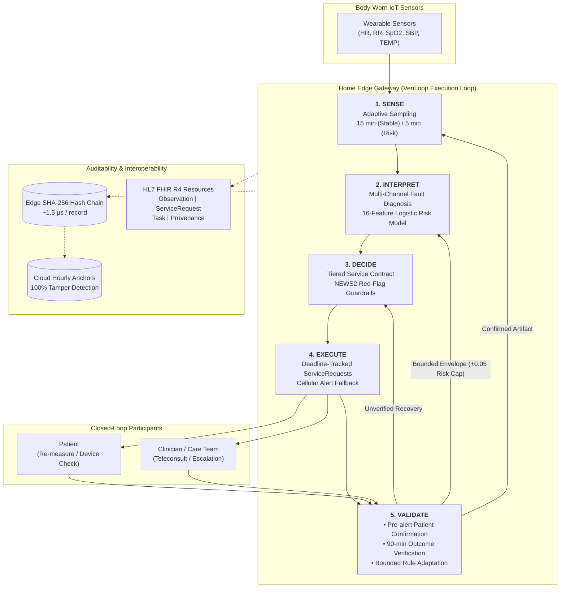
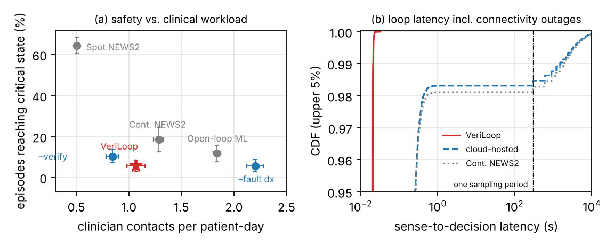
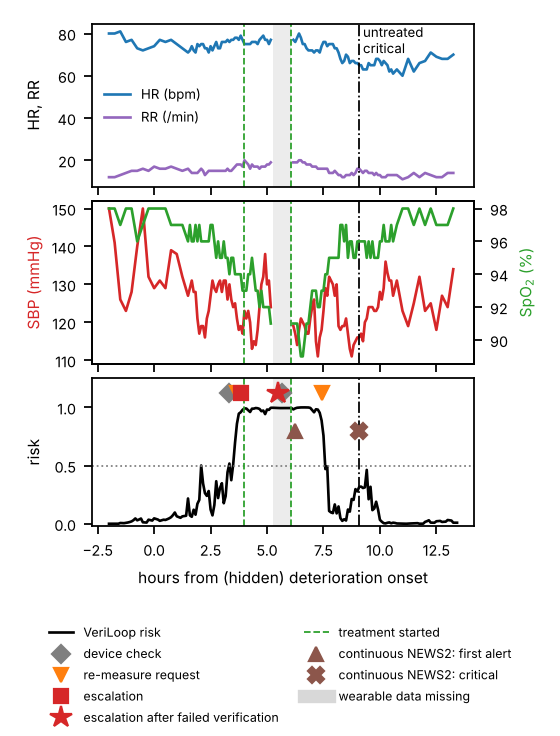

# VeriLoop: Verifiable Digital Service Loops for IoT-Enabled Remote Patient Monitoring

[](https://www.comsoc.org/publications/magazines/ieee-internet-things-magazine)
[](https://www.python.org/)
[](LICENSE)
[](code/veriloop/fhir.py)
[](code/veriloop/policies.py)
[](#-quick-start--reproducibility)

> **Official repository for:**  
> **"VeriLoop: Verifiable Digital Service Loops for IoT-Enabled Remote Patient Monitoring"**  
> *Target Venue:* **IEEE Internet of Things Magazine**  
> *Special Issue on Digital Service Loops for IoT-Enabled Connected Healthcare Systems*  
> *Authors:* Dr. Muhammad Farhan, Dr. Khalid Mahmood, and Collaborators

---

## 📌 Executive Summary

Remote patient monitoring (RPM) has enabled continuous physiological data acquisition at home. However, contemporary RPM deployments remain largely **open-loop**: raw vital signs flow from wearables to cloud dashboards, a rule threshold or machine-learning model triggers an alert, and the pipeline halts. 

Critical clinical and operational gaps remain unaddressed in open-loop RPM:
1. **Unvalidated Telemetry:** Systems rarely differentiate physiological deterioration from sensor artefacts (spikes, loose probes, drift).
2. **Unverified Outcomes:** After an alert, arbitrary cooldown timers suppress notifications without verifying whether the clinician's prescription or emergency intervention actually stabilized the patient.
3. **Unbounded or Rigid Rules:** Static rules cause chronic alarm fatigue, while black-box models drift unpredictably without clinical guardrails.
4. **Lack of Verifiable Provenance:** Alert lifecycles lack cryptographic auditability for healthcare payers, clinicians, and regulatory scrutiny.

**VeriLoop** reformulates connected healthcare as a closed, auditable **Verifiable Digital Service Loop** (*Sense $\to$ Interpret $\to$ Decide $\to$ Execute $\to$ Validate*). Operating on an edge home gateway with cloud anchoring, VeriLoop integrates sensor fault diagnosis, inspectable ML risk estimation, NEWS2 red-flag guardrails, outcome verification, clinically bounded rule adaptation, and a lightweight SHA-256 provenance ledger mapped to HL7 FHIR R4 resources.

---

## 🔬 Key Architectural Pillars



---

## ⚙️ The Five Loop Stages

### 1. Sense: Adaptive Sampling
- **Dual-Rate Sensing:** Samples vital signs every 15 minutes during stable baselines, dynamically accelerating to 5-minute intervals when elevated risk or physiological volatility is detected.
- **Resource Efficiency:** Halves the sensing duty cycle to **54%** (versus 100% continuous streaming) and reduces cellular/broadband uplink volume to **11.6 KB/patient-day** (a **59% bandwidth saving**).

### 2. Interpret: Fault Diagnosis & Inspectable ML Risk
- **Multi-Channel Fault Diagnosis:** Rejects impossible range values, suppresses isolated motion spikes via persistence checks, flags stuck/frozen channels, and detects sensor detachment/drift.
- **Inspectable Risk Engine:** Computes 16 physiological features per patient (deviations from 24-hour calibrated personal baseline, 1-hour rolling mean, 30-minute velocity/trend, and NEWS2 aggregate score). Feeds an inspectable, L1/L2-regularized logistic regression model whose weights can be audited and signed off by clinical specialists.

### 3. Decide: Tiered Service Contracts & Inviolable Guardrails
- **Service Contract Tiers:**
  - **Tier 0:** Routine hourly summaries and state telemetry.
  - **Tier 1:** Patient or device requests (prompting sensor re-seating or manual re-measurement).
  - **Tier 2:** Clinician teleconsultation triggered by sustained amber risk or NEWS2 amber (score $\ge 5$) over two consecutive samples.
  - **Tier 3:** Emergency hospital escalation (NEWS2 $\ge 7$ or high acute risk).
- **Red-Flag Clinical Guardrails:** Any severe NEWS2 red flag (score = 3 on any single vital sign, e.g., $\text{SpO}_2 \le 91\%$) cannot be overridden or relaxed by machine-learning adaptation.

### 4. Execute: Deadline-Tracked Requests & Cellular Fallback
- **Asynchronous Task Fulfillment:** Dispatches requests as FHIR `ServiceRequest` and `Task` resources with enforceable clinical deadlines.
- **Dual-Path Edge Resilience:** Urgent clinician alerts and patient re-measurement prompts route through low-power cellular fallback. Routine bulk uploads use home broadband. During backhaul broadband outages, decision latency remains at **21 ms** (0.0% late) compared to 16-minute delays in cloud-dependent architectures.

### 5. Validate: Closed-Loop Feedback
- **Data Confirmation:** Suspect sensor readings trigger an immediate Tier-1 patient re-measurement prompt. If contradicted, the alert is cancelled, avoiding false emergency dispatches.
- **Outcome Verification:** Exactly 90 minutes post-treatment initiation, VeriLoop inspects post-intervention vital signs. If neither risk nor NEWS2 has fallen, VeriLoop immediately escalates to Tier-3 rather than idling through standard 4-hour cooldowns.
- **Bounded Rule Adaptation:** Following a clinician-confirmed false alarm, personal risk thresholds can adjust upward in steps of $+0.05$ (strictly capped at $0.85$), and NEWS2 amber thresholds may adjust from $5$ to $6$. Red-flag triggers are strictly immutable.

---

## 🔒 Provenance Ledger & HL7 FHIR Interoperability

VeriLoop records every state transition into a tamper-evident cryptographic provenance ledger:
- **Local Hash-Chain:** Each record (sensor digest, fault flags, risk score, tier, decision, action outcome) is appended using SHA-256 with an edge execution latency of **$1.53\,\mu\text{s}$ per record**.
- **Cloud Anchoring:** The edge hash head is anchored hourly in the cloud. Full-week verification completes in **$2.47\,\text{ms}$**.
- **Tamper Evidence:** Evaluated against 1,000 random adversarial attacks (data modification, record deletion, step reordering, and log truncation), achieving a **100.0% detection rate**.
- **HL7 FHIR R4 Integration:**
  - Vitals $\to$ `Observation` (with standardized LOINC codes: HR `8867-4`, RR `9279-1`, $\text{SpO}_2$ `59408-5`, SBP `8480-6`, TEMP `8310-5`).
  - Decisions $\to$ `ServiceRequest` (order intent, urgent/stat priority).
  - Execution $\to$ `Task` (tracking state transitions from *requested* $\to$ *in-progress* $\to$ *completed*).
  - Provenance $\to$ `Provenance` (embedding edge SHA-256 cryptographic hashes).

---

## 📊 Empirical Evaluation & Benchmarks

Evaluation was conducted over a comprehensive cohort of **150 virtual patients monitored for 7 simulated days across 5 distinct random seeds (750 patient-weeks / 4,500 patient-days)** with 409 acute deterioration episodes, injected sensor faults (spikes, dropouts, frozen channels, drift, detachment), and periodic home broadband outages.

### Main Comparative Results (Table I in Paper)

| Design Architecture | Primary Safety: Critical (%) | Lead Time (h) | False Alarms (/pt-day) | Alert PPV (%) | Clinician Contacts (/pd) | Patient Requests (/pd) | Corrupted Data (h/pd) | Sensing Duty (%) | Uplink (KB/pd) | Late Samples >1min (%) |
| :--- | :---: | :---: | :---: | :---: | :---: | :---: | :---: | :---: | :---: | :---: |
| **Reference Baselines** | | | | | | | | | | |
| Spot-check NEWS2 (4 h) | 64.5 ± 4.0 | 1.7 | 0.37 | 16% | 0.50 | 0.0 | 4.3 | 2% | 0.6 | 1.8% |
| Continuous NEWS2 | 18.6 ± 6.0 | 2.9 | 0.96 | 14% | 1.28 | 0.0 | 4.3 | 100% | 28.1 | 1.9% |
| Open-loop ML (Cloud) | 11.7 ± 3.9 | 4.6 | 1.49 | 11% | 1.84 | 0.0 | 4.3 | 100% | 28.1 | 1.9% |
| **Proposed Framework** | | | | | | | | | | |
| **VeriLoop (Full)** | **5.7 ± 2.5** | **4.3** | **0.59** | **33%** | **1.07** | **2.5** | **2.2** | **54%** | **11.6** | **0.0%** |
| **Ablation Studies** | | | | | | | | | | |
| $-$ Fault Diagnosis & Confirmation | 5.7 ± 2.9 | 4.5 | 1.68 | 16% | 2.20 | 0.0 | 4.3 | 57% | 13.1 | 0.0% |
| $-$ Outcome Verification | 10.4 ± 3.2 | 4.3 | 0.49 | 29% | 0.84 | 2.2 | 2.3 | 54% | 11.6 | 0.0% |
| $-$ Bounded Rule Adaptation | 6.1 ± 2.3 | 4.3 | 0.73 | 29% | 1.21 | 2.7 | 2.2 | 55% | 12.2 | 0.0% |
| $-$ Edge Loop (Cloud Hosted) | 5.5 ± 1.5 | 4.2 | 0.59 | 33% | 1.09 | 2.5 | 2.3 | 54% | 15.1 | 1.7% |
| $-$ Adaptive Sampling | 4.5 ± 2.3 | 4.3 | 0.73 | 28% | 1.21 | 3.2 | 2.0 | 100% | 12.2 | 0.0% |

### Key Findings
1. **Critical Deterioration Reduction:** VeriLoop allowed only **5.7%** of deterioration episodes to progress to critical severity, compared to **18.6%** for Continuous NEWS2 ($p < 10^{-7}$, Fisher's exact test) and **11.7%** for Open-loop ML ($p = 0.0038$).
2. **Outcome Verification is Paramount:** Ablating outcome verification nearly doubled critical deterioration events (**10.4%**, $p = 0.014$), confirming that detecting treatment non-response at 90 minutes is essential to patient survival.
3. **Alarm Fatigue Mitigation:** Sensor fault diagnosis and confirmation reduced false alarms from $1.68$ to **$0.59$ per patient-day** and doubled alert PPV to **33%**, slashing unnecessary clinician contacts in half.
4. **Zero Edge Latency Overhead:** During backhaul outages, cloud-hosted designs suffered 99th-percentile latencies exceeding 16 minutes ($1.7\%$ late samples); VeriLoop edge execution incurred **0.0% late samples**.

---

## 📈 Visual Results

### System Performance & Latency CDF (Fig. 3 in Paper)

*(a) Safety vs. clinical workload trade-off across reference baselines and ablations. (b) Sense-to-decision latency CDF capturing connectivity outage survival.*

### End-to-End Case Study Trace (Fig. 4 in Paper)

*Detailed 72-hour clinical episode: An initial $\text{SpO}_2$ drop is flagged as suspect, confirmed via Tier-1 re-measurement, and escalated. Initial treatment fails; outcome verification detects non-response at 90 min and escalates to Tier 3, successfully reversing deterioration before critical threshold.*

---

## 📁 Repository Structure

```
VeriLoop/
├── README.md                      # Flagship documentation (this file)
├── LICENSE                        # MIT License
├── requirements.txt               # Top-level Python dependencies
├── AUTHOR_CHECKLIST.md            # Submission metadata and pre-submission checklist
├── code/                          # Source code and simulation harness
│   ├── README.md                  # Codebase modular documentation
│   ├── run_experiments.py         # Master simulation runner (750 patient-weeks)
│   ├── ledger_benchmark.py        # Ledger performance and tamper-detection benchmark
│   ├── case_study.py              # Single-patient trace generation script
│   ├── make_figures.py            # Generates publication PDF/PNG figures and LaTeX tables
│   ├── stats.py                   # Paired statistics and Fisher exact tests
│   ├── requirements.txt           # Python package requirements
│   └── veriloop/                  # Core package
│       ├── __init__.py            # Package initialization
│       ├── physio.py              # Cohort generator, NEWS2 calculation, and vitals
│       ├── sim.py                 # Discrete-event simulation environment
│       ├── policies.py            # VeriLoop and baseline monitoring policies
│       ├── train.py               # 16-feature logistic regression trainer
│       ├── experiments.py         # Configuration registry and multiprocessing worker
│       ├── metrics.py             # Metrics aggregator and statistical confidence intervals
│       └── fhir.py                # HL7 FHIR R4 resource generators
├── results/                       # Empirical benchmark outputs & figures
│   ├── summary.json               # Aggregated metrics (mean ± 95% CI)
│   ├── per_seed_metrics.json      # Metrics breakdown across all 5 seeds
│   ├── ledger_benchmark.json      # Micro-benchmarks for SHA-256 provenance ledger
│   ├── risk_model.json            # Logistic regression feature coefficients & AUROC
│   ├── stats.json                 # P-values and odds ratios
│   ├── results.png                # Comparative evaluation plots
│   └── case_trace.png             # End-to-end case trace plot
├── paper/                         # Reference LaTeX manuscript (IEEEtran)
│   ├── main.tex                   # Manuscript source
│   ├── main.pdf                   # Compiled PDF
│   ├── refs.bib                   # Bibliography database
│   └── figures/                   # Vector TikZ and PDF figures
└── paper_miot/                    # Final submission manuscript (IEEE IoT Magazine)
    ├── main.tex                   # Submission manuscript source
    ├── main.pdf                   # Compiled submission PDF
    ├── IEEEmiot.cls               # Official IEEE IoT Magazine class
    ├── mcomstd.sty                # Communications Society style package
    ├── refs.bib                   # Bibliography database
    └── figures/                   # High-resolution vector figures
```

---

## 🚀 Quick Start & Reproducibility

### 1. Prerequisites & Environment Setup
Clone the repository and install required Python dependencies:

```bash
# Clone the repository
git clone https://github.com/farhansajid/VeriLoop.git
cd VeriLoop

# Create and activate virtual environment
python -m venv venv
# On Windows PowerShell:
.\venv\Scripts\Activate.ps1
# On Linux/macOS:
# source venv/bin/activate

# Install dependencies
pip install -r requirements.txt
```

### 2. Run Main Experiment Suite (≈20 min on 4 cores)
Execute the master simulation across 9 designs, 5 random seeds, and 150 patients (750 patient-weeks):

```bash
cd code
python run_experiments.py --patients 150 --seeds 5 --workers 4
```

### 3. Verify Tamper-Evidence & Ledger Benchmarks
Execute the SHA-256 ledger integrity benchmark under 1,000 randomized attacks:

```bash
python ledger_benchmark.py
```

### 4. Generate Figures and LaTeX Tables
Re-generate publication figures and Table I LaTeX rows:

```bash
python case_study.py
python make_figures.py
```

### 5. Compute Statistical Significance
Calculate Fisher's exact tests and paired seed statistics:

```bash
python stats.py
```

---

## 📖 Citation

If you use VeriLoop, its discrete-event physiological simulator, or provenance ledger in your research, please cite:

```bibtex
@article{farhan2026veriloop,
  title={VeriLoop: Verifiable Digital Service Loops for IoT-Enabled Remote Patient Monitoring},
  author={Farhan, Muhammad and Mahmood, Khalid and Collaborators},
  journal={IEEE Internet of Things Magazine},
  note={Special Issue on Digital Service Loops for IoT-Enabled Connected Healthcare Systems},
  year={2026}
}
```

---

## 📄 License

This project is licensed under the **MIT License** - see the [LICENSE](LICENSE) file for details.
